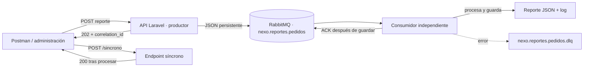
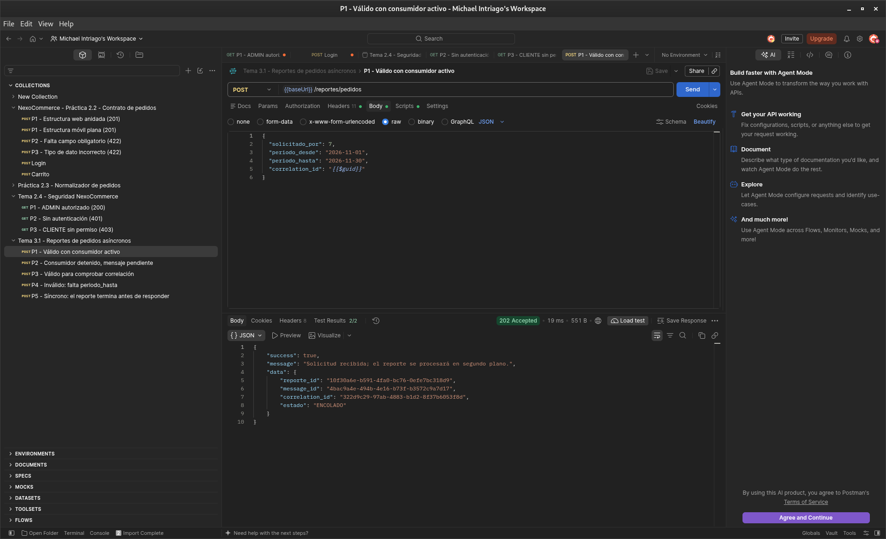
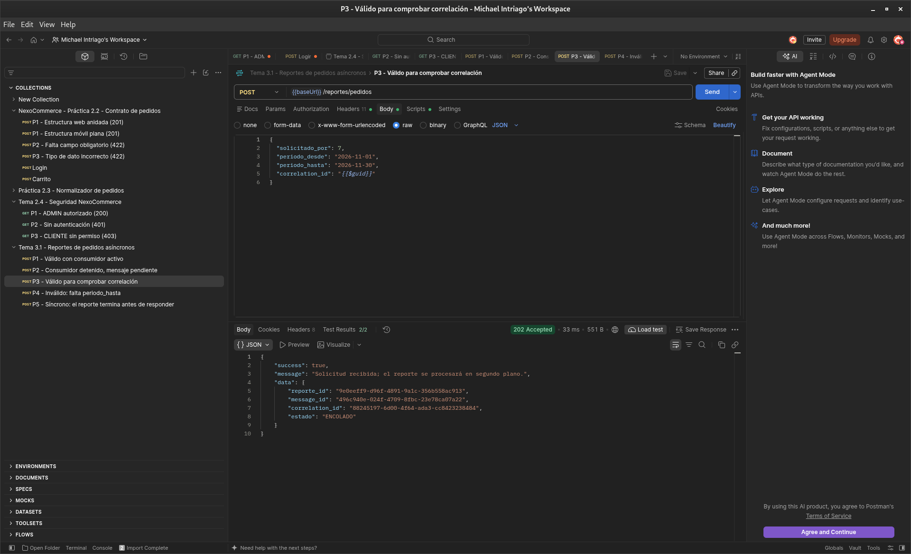
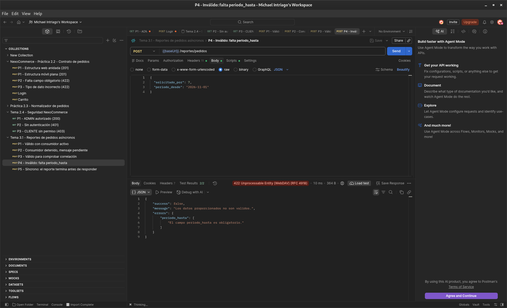
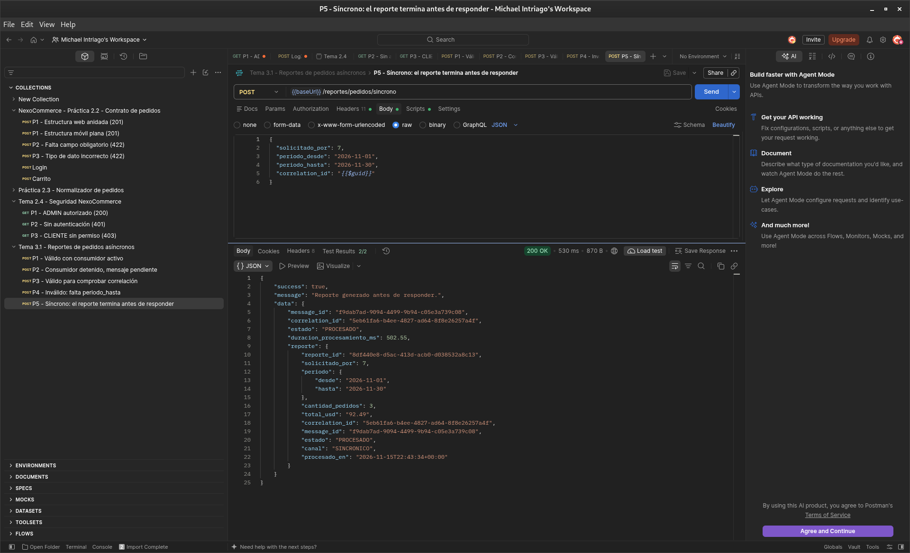

# Práctica individual · Tema 3.1

**Proyecto:** NexoCommerce · **Proceso:** generar un reporte agregado de pedidos para administración.

La solicitud síncrona genera y devuelve el reporte dentro de la petición. La ruta asíncrona publica la solicitud en RabbitMQ y responde `202 Accepted`; el consumidor la procesa en segundo plano. El reporte agregado de pedidos es un proceso apropiado para ejecutarse después de aceptar la solicitud, con datos ficticios para verificar el cálculo.

## Flujo y mensaje

- Productor Laravel: `POST /api/practica/v1/reportes/pedidos`.
- Broker y cola durable: RabbitMQ · `nexo.reportes.pedidos`; errores: `nexo.reportes.pedidos.dlq`.
- Consumidor: `php artisan practica31:consumir-reportes`; genera un JSON de reporte y registra `PROCESADO`. Envía ACK después de guardar; un error se rechaza hacia la DLQ.
- Comparación síncrona: `POST /api/practica/v1/reportes/pedidos/sincrono`.

El `message_id` identifica un mensaje particular. El `correlation_id` enlaza la respuesta del productor con el estado/log del consumidor. El backend crea ambos valores como UUID y permite enviar un `correlation_id` válido desde Postman.

```json
{
  "message_id": "UUID generado",
  "correlation_id": "UUID generado o recibido",
  "tipo": "reporte.pedidos.solicitado",
  "ocurrido_en": "fecha UTC",
  "payload": {
    "reporte_id": "UUID",
    "solicitado_por": 7,
    "periodo_desde": "2026-11-01",
    "periodo_hasta": "2026-11-30"
  }
}
```

Diagrama del flujo:



El diagrama también está en [diagram.mmd](diagram.mmd). Código del productor, consumidor, validación y procesamiento: [codigo/](codigo/).

## Ejecución local

El runtime Laravel usado por Docker se prepara en `runtime/backend` sin copiar `.env`. Si recibiste la carpeta sin `runtime/backend`, ejecuta desde la carpeta de la práctica:

```bash
NEXO_BACKEND_DIR=/ruta/a/NexoCommerce/backend ./scripts/preparar-entorno.sh
```

Luego prepara configuración ficticia local y levanta servicios:

```bash
cp .env.example .env
docker compose up -d --build rabbitmq api
docker compose up -d consumer
```

Importa [postman/Tema-3-1-Reportes.postman_collection.json](postman/Tema-3-1-Reportes.postman_collection.json). La API escucha en `http://127.0.0.1:8011`; el panel de RabbitMQ en `http://127.0.0.1:15673`. `.env.example` contiene credenciales de demostración solo para localhost. No incluyas `.env` en la entrega.

Para demostrar mensajes pendientes, detén solo este consumidor, envía P2 en Postman y revisa la cola; después vuelve a iniciarlo:

```bash
docker compose stop consumer
docker compose exec rabbitmq rabbitmqctl list_queues name messages_ready messages_unacknowledged
docker compose start consumer
docker compose logs -f consumer
```

## Pruebas ejecutadas en Docker

Se enviaron tres mensajes válidos y se verificaron logs con el mismo `correlation_id` que devolvió la API. Cada reporte ficticio para noviembre contiene 3 pedidos y total de USD 92.49.

| Caso | Resultado observado |
|---|---|
| P1 · válido, consumidor activo | Postman HTTP 202 en 19 ms; consumidor registró `PROCESADO`. |
| P2 · consumidor detenido | Postman HTTP 202 en 28 ms; `messages_ready=1`, `messages_unacknowledged=0`. Al reanudarlo, se procesó y la cola quedó en cero. |
| P3 · correlación | Postman HTTP 202 en 33 ms; correlation ID visible en la respuesta y el consumidor. |
| P4 · falta `periodo_hasta` | HTTP 422 con error explícito de validación. |
| P5 · síncrono | Postman HTTP 200; 530 ms total, 502.55 ms de procesamiento. |

El cliente recibe la confirmación asíncrona sin esperar los ~500 ms del trabajo. Las respuestas automatizadas complementarias y los reportes generados están en [evidencias/](evidencias/).

| Aspecto | Síncrona | Asíncrona |
|---|---|---|
| Respuesta inicial | 530 ms; espera el reporte. | 19–33 ms en las pruebas Postman; devuelve 202. |
| Indisponibilidad | La petición depende del proceso y mantiene ocupado el endpoint. | Si se detiene el consumidor, el broker retiene el mensaje; si RabbitMQ no confirma, la API devuelve 503. |
| Trazabilidad | correlation_id en respuesta y resultado. | message_id identifica cada mensaje y correlation_id enlaza productor y consumidor. |

## Capturas de Postman

### P1 · Mensaje válido con el consumidor activo



### P2 · Consumidor detenido


La cola registró `messages_ready=1` y `messages_unacknowledged=0`; después de reanudar el consumidor quedó en `0/0`. Las salidas están en `evidencias/P2-cola-pendiente.txt` y `evidencias/P2-cola-reanudada.txt`.

### P3 · Correlación



### P4 · Validación de mensaje inválido



### P5 · Comparación síncrona



## Archivos de entrega

- Código funcional del productor y consumidor: `codigo/app/Practica31/`.
- Informe breve: `docs/Informe_Practica_Tema_3_1.docx`.
- Diagrama del flujo: `diagram.mmd`.
- Pruebas importables en Postman: `postman/Tema-3-1-Reportes.postman_collection.json`.
- Evidencias de respuestas HTTP, cola y logs: `evidencias/`.

Las capturas visuales P1–P5 se conservan junto con las entradas, salidas HTTP y logs. Se usaron únicamente datos ficticios de prueba.
